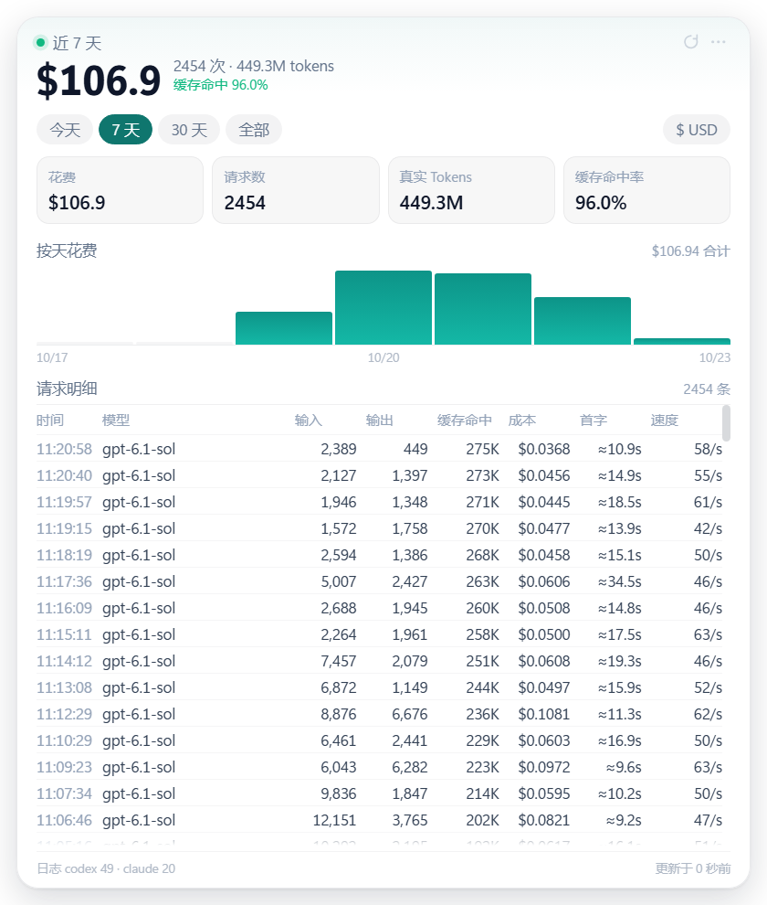
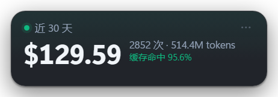
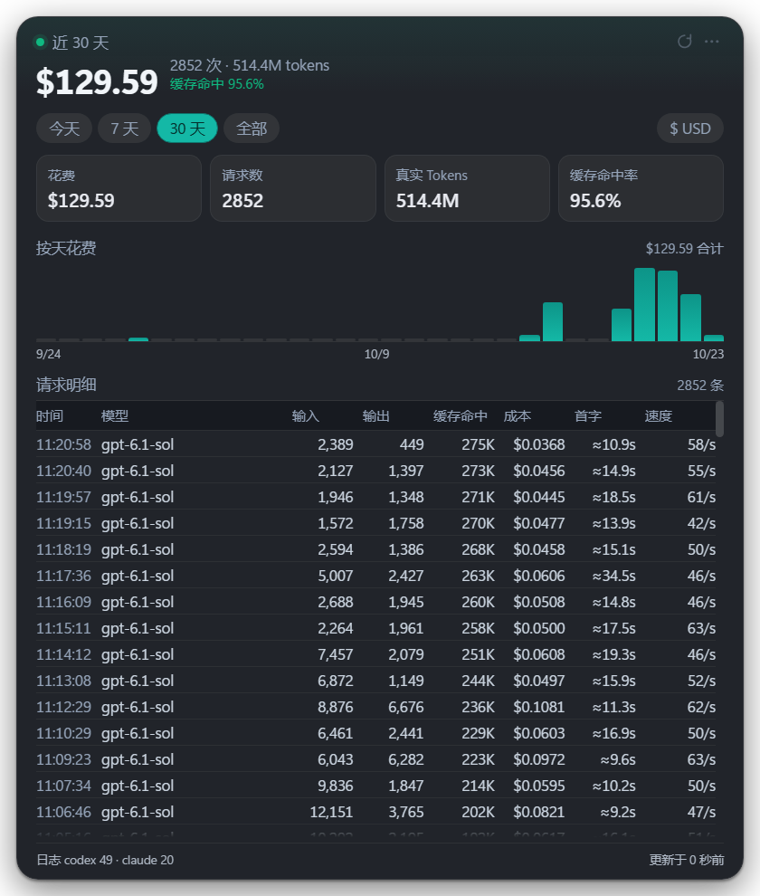

# CC Usage Float · 用量悬浮窗

从 [cc-switch](https://github.com/farion1231/cc-switch) 的「用量统计」模块里单独摘出来的
Windows 桌面悬浮窗：**默认只显示今日花费金额，点一下展开看趋势和逐条请求明细。**

只读本地会话日志，不联网、不发请求、不改任何配置。

| 收起（只给金额） | 展开（趋势 + 明细） |
| --- | --- |
|  |  |
|  |  |

---

## 一、和 cc-switch 的关系

cc-switch 是 Tauri 2 + React + Rust 的 All-in-One 助手，它的用量面板靠两段代码支撑：

| 层 | cc-switch 里的位置 | 这个工程里 |
| --- | --- | --- |
| 日志采集 | `src-tauri/src/services/session_usage_codex.rs`（6328 行）<br>`session_usage_claude*` / `session_usage_gemini.rs` … | `src/main/scanner/codex.js`、`claude.js` |
| 计费 | `src-tauri/src/proxy/usage/calculator.rs`<br>`src-tauri/src/services/model_pricing.rs` | `src/main/scanner/pricing.js` |
| 聚合查询 | `src-tauri/src/services/usage_stats.rs` + SQLite `proxy_request_logs` | `src/main/scanner/index.js`（纯内存聚合） |
| 界面 | `src/components/usage/*.tsx`（React + Tailwind + recharts） | `src/renderer/*`（原生 HTML/CSS，无框架） |

摘除时砍掉的部分：SQLite 落库、增量游标、代理侧实时记账、多 app 兼容层（gemini/grok/pi…）、
国际化、models.dev 之外的远端定价同步 UI。**保留并逐条移植的，是决定数字准不准的三件事**：

1. **优先用 `last_token_usage`**：Codex 自己算好的单次请求用量，比拿累计值差分准；
   只有它缺失时才退化成 `total_token_usage` 的高水位差分。
2. **重复快照去重**：限额刷新时 Codex 会把同一份 `token_count` 再写一次，签名相同就不计数。
3. **fork / 子代理的历史重放剔除**：子会话会把父会话的事件重放一遍，不按签名前缀剔掉就会双算。
   本机 49 个 rollout 里有 14 个带 `forked_from_id` / `parent_thread_id`，这条不能省。

计费口径同样照搬：

- Codex / OpenAI 的 `input_tokens` **包含**缓存读写，计费前要扣掉；
- Claude / Anthropic 的 `input_tokens` **不含**缓存，直接用；
- Claude 1 小时缓存写入按定价表 `cacheWrite` 的 1.6 倍计。

### 对齐验证

拿 cc-switch 自己渲染的今日数据（截图：`$3.21 / 56 请求 / 11.1M tokens / 94.5%`）比对：

```
[today] cost=$3.2107 requests=56 tokens=11.1M in=608K out=95K cacheR=10.4M hitRate=94.5%
```

四个指标全部一致（金额差 0.0007 来自展示舍入）。定价取自 models.dev，
`gpt-6.1-sol = 2 / 10 / 0.1`（input / output / cache_read，USD per 1M）。

---

## 二、跑起来

```bash
npm install          # 只装 electron
npm start            # = electron .
```

或者双击 `start.bat`。

> **启动即退出、日志里有 `GPU process isn't usable`？**
> 这是 Chromium GPU 沙箱在受限会话里崩了，改用 `start-compat.bat`
> （等价 `--no-sandbox --disable-gpu`）。默认已经关掉硬件加速，正常情况下不需要。

命令行校验数据、不启动界面：

```bash
npm run probe        # 打印 today/7d/30d/all 的汇总、按模型、按天、最近明细
```

---

## 三、交互

| 操作 | 效果 |
| --- | --- |
| 单击卡片 | 展开 / 收起 |
| 按住拖动 | 移动窗口（位置记住） |
| 滚轮 | 切时间范围：今天 → 7 天 → 30 天 → 全部（明细表内滚动不触发） |
| `Esc` | 收起 |
| 双击顶部「今日」 | 切浅色 / 深色 |
| 右键 | 菜单：置顶 / 开机自启动 / 刷新间隔 / 透明度 / 立即刷新 / 打开定价文件 / 同步定价 / 退出 |
| `Ctrl+Alt+U` | 显示 / 隐藏窗口 |
| 点 `$ USD` | 切人民币显示（汇率读 `pricing.json` 的 `usdToCny`） |

窗口特性：无边框、半透明、置顶、不进任务栏、单实例、位置与范围持久化到
`%APPDATA%\CC Usage Float\config.json`。

### 开机自启动

右键菜单勾选「开机自启动」即可，状态直接读系统登录项（
`HKCU\Software\Microsoft\Windows\CurrentVersion\Run`），不在 `config.json` 里另存一份，
所以你在任务管理器里手动禁用后，菜单勾选也会跟着变。

- **开发模式**（`npm start` / `start.bat`）：登录项指向 `node_modules/electron/dist/electron.exe`，
  并带上工程目录作为参数，否则开机只会拉起一个空的 Electron 壳；
- **打包后**：登录项指向产品 exe，不需要额外参数；
- 如果平时用 `start-compat.bat` 启动，自启动会一并写入 `--no-sandbox --disable-gpu`，
  避免开机时因为 GPU 沙箱崩溃而闪退；
- 写入被安全软件拦下时会弹窗提示，不会留下"以为设上了其实没设"的假象。

---

## 四、数据来源

| app | 路径 | 解析粒度 |
| --- | --- | --- |
| Codex | `~/.codex/sessions/YYYY/MM/DD/rollout-*.jsonl` | 每个 `token_count` 事件 = 一次请求 |
| Claude Code | `~/.claude/projects/*/*.jsonl` | 每条带 `usage` 的 assistant 消息 = 一次请求（按 `message.id` 去重） |

文件按 `mtime + size` 缓存解析结果，只重新解析改动过的文件；30 秒自动刷新（可调）。

要在 WSL / 其他用户目录里扫日志，往 `config.json` 的 `extraRoots` 里加绝对路径：

```json
{
  "extraRoots": {
    "codex": ["\\\\wsl$\\Ubuntu\\home\\you\\.codex\\sessions"],
    "claude": ["\\\\wsl$\\Ubuntu\\home\\you\\.claude\\projects"]
  }
}
```

---

## 五、定价

`data/pricing.json`，单位 USD / 100 万 tokens：

```json
{
  "usdToCny": 7.2,
  "models": {
    "gpt-6.1-sol": { "name": "GPT-6.1 Sol", "input": 2, "output": 10, "cacheRead": 0.1, "cacheWrite": 2.5 }
  }
}
```

- 右键「重新同步定价」从 models.dev 拉全量（3600+ 模型），只取基础档，不取大上下文阶梯价；
- 手改的模型写进 `overrides` 就不会被下次同步覆盖；
- 查不到价的模型按 0 计费，明细里成本列显示 `—`，不会静默塞一个瞎猜的价。

---

## 六、已知差异

- **续写页（paginated）跨文件基线**：cc-switch 会回读前序分段取高水位基线，这里按文件内高水位处理，
  极端情况下这类会话的单条 token 归因会有几千 token 的偏差（总量不受影响，实测今日总额完全一致）；
- **耗时 / 首字**：Codex 日志没有请求级计时，全靠事件顺序推算（同 cc-switch 的思路），
  所以带 `≈`，与真实耗时可能差几秒；
- 成功率：会话日志里没有 HTTP 状态码，这一格换成了**缓存命中率**（更有信息量）。

---

## 七、打包与发布

### 本地打包

```bash
npm run dist:win        # 产物：dist/cc-usage-float-<version>-x64.exe
```

portable 单文件，双击即跑、无需安装；`requestExecutionLevel` 设为 `user`，不会弹 UAC。

### CI 自动打包（GitHub Actions）

配置在 `.github/workflows/build.yml`：

| 触发 | 结果 |
| --- | --- |
| push 到 `main` | 构建 exe，挂到该次 Actions 的 artifacts，保留 30 天（不产生 Release） |
| 打 tag `v*`（如 `v0.1.0`） | 构建 exe，创建 GitHub Release 并上传 exe，正文自动生成 |
| 手动 `workflow_dispatch` | 只做构建 + artifact，不发布 |

发版流程：

```bash
npm version patch          # 或 minor / major：改 package.json 版本号并打 tag
git push --follow-tags     # 推提交 + 推 tag，触发 Release
```

workflow 会校验 tag 与 `package.json` 的 `version` 是否一致，不一致直接失败，
避免出现「tag 是 v0.2.0、产物却叫 0.1.0」这种对不上的情况。

其他约定：

- runner 用 `windows-latest`，`npm ci` 显式指定 npmmirror（与 lock 文件里的 `resolved` 一致）；
- CI 上无代码签名证书，设 `CSC_IDENTITY_AUTO_DISCOVERY=false` 跳过证书探测，产物未签名，
  Windows 首次运行可能提示「已保护你的电脑」，需要点「更多信息 → 仍要运行」；
- `concurrency` 按 ref 分组，同一分支连推会取消上一次未完成的构建。

> **便携版已知限制**：`data/pricing.json` 打进 asar 后是只读的，
> 右键「重新同步定价」写入会失败。开发模式（`npm start`）没有这个问题。
> 需要可编辑的话，下一步应把定价表移到 `app.getPath('userData')`，首次启动时从内置副本拷一份。

---

## 目录

```
cc-usage-float/
├── main.js                     # 主进程：窗口形态、拖动、菜单、IPC、刷新
├── preload.js                  # contextBridge 白名单
├── start.bat                   # 普通启动
├── start-compat.bat            # 绕开 GPU 沙箱（--no-sandbox --disable-gpu）
├── data/pricing.json           # 定价表（可编辑）
├── docs/                       # 预览截图（README 内的四张）
├── scripts/
│   ├── probe.js                # 命令行探针
│   ├── sync-pricing.js         # models.dev 定价同步
│   └── shot_window.py          # 按窗口标题截图，用于界面改动后的视觉复核
└── src/
    ├── main/scanner/
    │   ├── codex.js            # Codex rollout 解析（含 fork 重放剔除）
    │   ├── claude.js           # Claude Code 会话解析
    │   ├── pricing.js          # 定价查找 + 成本计算
    │   └── index.js            # 文件发现 / mtime 缓存 / 时间窗聚合
    └── renderer/               # index.html + style.css + app.js
```

---

## 许可

[MIT](LICENSE) © 2026 zhenyu_gao

